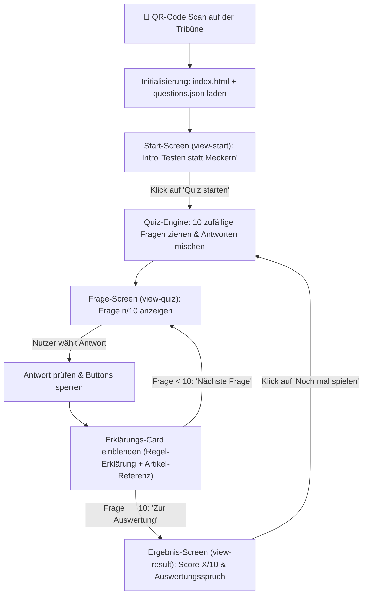

# IMPLEMENTATION.md – Architektur & Technische Dokumentation

Dieses Dokument beschreibt die technische Architektur, das Datenmodell, die Quiz-Logik sowie die Umsetzung des Design-Systems für die statische Webapp **„Testen statt Meckern"** der **BG BiBA**.

---

## 1. Architektur-Überblick

### 1.1 Design-Philosophie: Static & Zero-Dependency
Die Anwendung wird auf **GitHub Pages** als rein statische Webseite betrieben und primär über einen QR-Code auf dem Smartphone in Sporthallen aufgerufen. Daraus ergeben sich folgende Architekturentscheidungen:

- **Vanilla Web Stack (HTML5 + CSS3 + ES6+ JavaScript):** Kein Build-Schritt zwingend erforderlich, keine externen Laufzeit-Abhängigkeiten (kein React/Vue/Angular-Overhead).
- **Single-Page-Flow (SPA im Kleinen):** Alle drei Ansichten (*Startscreen*, *Frage/Auflösung*, *Endauswertung*) befinden sich in einer einzigen `index.html` und werden zustandsgesteuert ein- und ausgeblendet.
- **Offline-Resilienz in der Sporthalle:** Sobald die Seite und der Fragenkatalog (`data/questions.json`) beim Scannen des QR-Codes einmal geladen wurden, läuft das gesamte Quiz inklusive weiterer Runden komplett im Arbeitsspeicher des Browsers – selbst wenn das Mobilfunknetz auf der Tribüne zwischendurch abbricht.
- **Relative Pfadführung:** Alle Ressourcen werden relativ (`./css/...`, `./js/...`, `./data/...`, `./assets/...`) referenziert, sodass die App ohne Konfigurationsänderung sowohl unter einer Root-Domain als auch unter `https://<user>.github.io/TestenStattMeckern/` funktioniert.

### 1.2 Programmablauf (User & Data Flow)



---

## 2. Verzeichnisstruktur

```text
e:\Projects\TestenStattMeckern\
├── index.html                  # Semantisches HTML5-Grundgerüst mit den 3 App-Screens
├── css/
│   └── styles.css              # BG BiBA Design Tokens, Layout, Komponenten, Animationen
├── js/
│   └── app.js                  # Quiz-State, Shuffle-Logik, DOM-Rendering, Share-API
├── data/
│   └── questions.json          # Kuratierter Fragenpool (mind. 25–40 Fragen für Abwechslung)
├── assets/
│   ├── bgbiba_full_small.png        # Primärlogo für helle Hintergründe
│   ├── bgbiba_full_black_white.png  # Sekundärlogo für dunkle/blaue Hintergründe
│   └── bgbiba_full_tiny.png         # Vereins-Icon / Favicon
├── dbb_2022/                   # [GITIGNORED] Lokale Referenz: DBB Basketball-Regeln 2022
├── fiba_2026/                  # [GITIGNORED] Lokale Referenz: FIBA Official Rules 2026
├── .gitignore                  # Schließt dbb_2022/ und fiba_2026/ strikt vom Repo aus
├── AGENTS.md                   # Regeln für KI-Agenten & Entwickler
├── IMPLEMENTATION.md           # Architektur- & Implementierungsdokumentation
└── README.md                   # Überblick für Endnutzer & Entwickler
```

---

## 3. Datenmodell (`data/questions.json`)

Damit das Quiz bei mehrfachem Spielen spannend bleibt, enthält `data/questions.json` einen Pool von deutlich mehr als 10 Fragen (Zielgröße: 30+ Fragen), aus dem pro Runde 10 Fragen zufällig gezogen werden.

### 3.1 JSON-Schema einer Frage

```json
{
  "id": "q-travel-zero-step",
  "category": "Schrittfehler & Dribbling",
  "officialRole": "Schiedsrichter",
  "question": "Ein Spieler fängt den Ball in voller Bewegung, während sein rechter Fuß gerade auf dem Boden ist. Wie viele Schritte darf er danach noch machen, um zum Korbwurf hochzugehen?",
  "options": [
    "Noch 2 Schritte (der Bodenkontakt beim Fangen zählt als Schritt 0)",
    "Nur noch 1 Schritt, weil der rechte Fuß schon als erster Schritt zählt",
    "Gar keinen Schritt mehr – er muss sofort abstoppen oder dribbeln",
    "3 Schritte, solange er in der Zone (Rechteck) abspringt"
  ],
  "correctIndex": 0,
  "explanation": "Seit der Einführung des sogenannten ‚Schritt 0' (Gather Step) zählt der Fuß, der im Moment der Ballkontrolle in der Bewegung bereits den Boden berührt, noch nicht zu den zwei erlaubten Schritten. Für Schiedsrichter heißt das: In Sekundenbruchteilen genau auf den Moment der Ballkontrolle UND die Fußstellung gleichzeitig achten!",
  "ruleReference": "DBB/FIBA Regel V – Art. 25.2.1 (Schrittfehler in der Bewegung)"
}
```

### 3.2 Felder-Spezifikation

| Feld | Typ | Beschreibung |
|---|---|---|
| `id` | `string` | Eindeutige, sprechende ID der Frage (z. B. `q-shotclock-14sec`). |
| `category` | `string` | Themenbereich für das Kategorie-Badge über der Frage (z. B. `Fouls & Kontakt`, `Zeitregeln`, `Kampfgericht & Anschreiber`, `Schrittfehler & Dribbling`, `Ausball & Rückspiel`). |
| `officialRole` | `string` | Hebt hervor, wer diese Entscheidung trifft (`Schiedsrichter`, `Kampfgericht / Anschreiber`, `24-Sekunden-Zeitnehmer`, `Schiedsrichter & Kampfgericht`). |
| `question` | `string` | Praxisnahe Beschreibung einer typischen Spielsituation, bei der auf der Tribüne oft diskutiert wird. |
| `options` | `string[]` | Array mit 3 oder 4 Antwortmöglichkeiten. Im JSON steht die richtige Antwort an Position `correctIndex`; zur Laufzeit werden die Optionen gemischt. |
| `correctIndex` | `number` | `0`-basierter Index der korrekten Antwort im ursprünglichen `options`-Array. |
| `explanation` | `string` | Leicht verständliche, lockere Auflösung, die auch erklärt, warum die Situation für Schiedsrichter oder Anschreiber anspruchsvoll ist. |
| `ruleReference` | `string` | Offizieller Verweis auf Regel und Artikel gemäß `dbb_2022/` bzw. `fiba_2026/`. |

---

## 4. Quiz-Engine & State Management (`js/app.js`)

### 4.1 Anwendungszustand (State)

```javascript
const quizState = {
  allQuestions: [],          // Geladener Gesamtpool aus questions.json
  recentQuestionIds: [],     // Zuletzt gestellte Fragen-IDs (vermeidet Dopplungen beim direkten Neustart)
  currentQuestions: [],      // Die 10 gezogenen Fragen der aktuellen Runde
  currentIndex: 0,           // Aktuelle Frage (0 bis 9)
  score: 0,                  // Anzahl richtiger Antworten (0 bis 10)
  isAnswered: false          // Sperrt Mehrfachklicks nach Auswahl einer Antwort
};
```

### 4.2 Zufallsauswahl & Faire Mischung (Fisher-Yates Shuffle)
1. **Fragen-Ziehung (`selectRandomQuestions`):**
   - Verwendet den **Fisher-Yates-Shuffle-Algorithmus** (`crypto.getRandomValues` oder `Math.random`), um den Fragenpool unvoreingenommen zu mischen.
   - **Wiederspiel-Optimierung:** Wenn der Nutzer am Ende auf *„Noch mal versuchen"* klickt, bevorzugt die Engine Fragen, die in der unmittelbar vorherigen Runde noch nicht dran waren, sofern der Pool groß genug ist.
2. **Antwort-Mischung (`shuffleOptions`):**
   - Für jede der 10 gezogenen Fragen werden die Antwortoptionen zusammen mit einem Flag `isCorrect` gemischt. Dadurch befindet sich die richtige Antwort jedes Mal an einer zufälligen Position (A, B, C oder D).

### 4.3 Auswertungs-Stufen (Score Tiers `0/10` bis `10/10`)
Die Auswertungsfunktion `getEvaluation(score)` liefert passend zur erreichten Punktzahl den Titel, den verbindlichen Auswertungstext und einen passenden Perspektiv-Hinweis zurück:

| Punkte (`score`) | Badge / Rang | Auswertungstext (Verbindlicher Tonfall) |
|---|---|---|
| **0 / 10** | 😅 *Tribünen-Rookie* | **„0/10 Richtige! Versuch es gleich noch einmal, vielleicht hast du ja etwas gelernt."** |
| **1–2 / 10** | 👀 *Bauchgefühl-Coach* | **„{score}/10 Richtige! Da war noch viel Bauchgefühl dabei – gar kein Problem! Jetzt weißt du, warum nicht jeder Kontakt oder stolpernde Schritt gleich ein Pfiff ist."** |
| **3–4 / 10** | 🏀 *Halbzeit-Theoretiker* | **„{score}/10 Richtige! Ein paar Grundlagen sitzen schon, aber Basketball hat es in sich. Unsere Schiris und Anschreiber müssen all diese Details im Sekundentakt parat haben."** |
| **5 / 10** | ⚖️ *Solides Mittelfeld* | **„5/10 Richtige! Das ist schon nicht schlecht, aber für den Schiri-Schein reicht es noch nicht."** |
| **6–7 / 10** | 👏 *Regel-Kenner* | **„{score}/10 Richtige! Starkes Ergebnis – du hast ein gutes Auge fürs Spiel! Und trotzdem merkt man bei den kniffligen Fragen, wie schnell man auf der Tribüne danebenliegen kann."** |
| **8–9 / 10** | 🔥 *Kampfgericht-Kandidat* | **„{score}/10 Richtige! Fast fehlerfrei! Mit diesem Regelwissen wärst du eine echte Verstärkung am Anschreibertisch oder mit der Pfeife auf dem Feld."** |
| **10 / 10** | 🏆 *Schiri-Versteher* | **„10/10 Richtige! Perfekt - Du weißt wahrscheinlich ganz genau wie schwer es ist immer die richtigen Entscheidungen zu treffen."** |

---

## 5. UI-Architektur & BG BiBA Design-System (`css/styles.css`)

Die Gestaltung setzt die [BG BiBA Brand Guidelines](https://wiki.bgbiba.de/books/media/page/bg-biba-brand-guidelines) konsequent um.

### 5.1 Design Tokens & Typografie
- **Schriftarten:**
  - Überschriften & Score-Anzeigen: `'Outfit', system-ui, -apple-system, sans-serif` (kräftig, sportlich, `font-weight: 700–800`).
  - Fließtext, Fragen & Antwort-Buttons: `'Inter', system-ui, -apple-system, sans-serif` (optimale Lesbarkeit auf kleinen Smartphone-Screens).
- **Farbverteilung (60-30-10 Regel):**
  - **60 % Neutral:** Seitenhintergrund `--biba-bg-bright` (`#F2F2F2`), Frage-Cards auf Reinweiß `--biba-white` (`#FFFFFF`) mit dezenter Kontur und leichtem Schatten.
  - **30 % Struktur (BiBA-Blau & Schwarz):** Top-Header, Fortschrittsbalken, Kategorie-Badges und Info-Boxen in `--biba-blue` (`#412774`) mit weißer Schrift (`#FFFFFF`); primärer Fragetext in `--biba-black` (`#000000`).
  - **10 % Akzent (BiBA-Rot):** Primäre Call-to-Action-Buttons (*„Quiz starten"*, *„Nächste Frage"*, *„Noch mal testen"*) in `--biba-red` (`#E2322A`) mit weißer Schrift (`#FFFFFF`).
- **Feedback-Farben (Semantisch für Quiz-Antworten):**
  - Richtige Antwort: Kräftiges Sport-Grün (`#15803D` / heller Hintergrund `#DCFCE7`) + `✓`-Icon (damit nicht allein Farbe entscheidet → Farbenblindheits-tauglich).
  - Falsche Antwort: BiBA-Rot (`#E2322A` / heller Hintergrund `#FEE2E2`) + `✗`-Icon.

### 5.2 Mobile-First Layout & Barrierefreiheit (A11y)
- **Container-Breite:** Zentrierter Mobile-Container (`max-width: 540px`, `margin: 0 auto`, `padding: 1rem`), der auf dem Smartphone den Bildschirm optimal ausfüllt und auf Tablets/Desktops wie eine aufgeräumte Quiz-Card wirkt.
- **Touch-Targets:** Jeder Antwort-Button hat mindestens `min-height: 52px`, `padding: 0.875rem 1rem` und großzügigen Abstand (`gap: 0.75rem`) zum nächsten Button, um Fehlklicks zu verhindern.
- **Tastatur & Screenreader:**
  - Nutzung echter `<button type="button">`-Elemente für alle Antworten.
  - Einsatz von `aria-live="polite"` für den Erklärungsbereich, sodass Screenreader das Feedback nach der Antwortauswahl automatisch vorlesen.
  - Sichtbare Fokus-Indikatoren (`:focus-visible`) mit `--biba-blue` bzw. `--biba-red`.
- **Logo-Regeln:**
  - Im dunklen/blauen Header wird `bgbiba_full_black_white` verwendet, auf hellen Cards `bgbiba_full_small`.
  - Mindestens `48 × 48 px` Darstellungsgröße und mindestens `10 %` Padding rundherum.

---

## 6. Qualitätssicherung & Pflege

### 6.1 Checkliste beim Erstellen oder Ändern von Fragen
1. **Praxisrelevanz:** Ist das eine Situation, die in einem normalen Jugend- oder Amateurspiel der BG BiBA vorkommt und bei der Zuschauer oft falsch liegen?
2. **Eindeutigkeit:** Ist genau **eine** Antwort nach DBB-/FIBA-Regelwerk zweifelsfrei richtig, ohne dass es auf versteckte Sonderfälle ankommt?
3. **Regel-Check:** Stimmt der referenzierte Artikel mit `dbb_2022/regeln_markdown/` und `fiba_2026/rules_markdown/` überein?
4. **Perspektivwechsel:** Zeigt die Erklärung freundlich auf, worauf Schiedsrichter oder Anschreiber in diesem Moment achten müssen?
5. **Git-Sicherheit:** Wurden keine Dateien aus `dbb_2022/` oder `fiba_2026/` zum Commit vorgemerkt (`git status` prüfen)?

